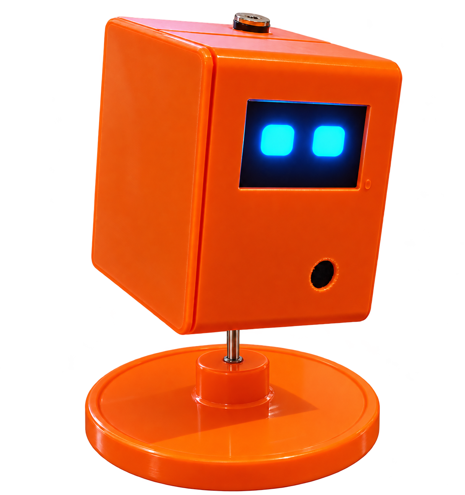
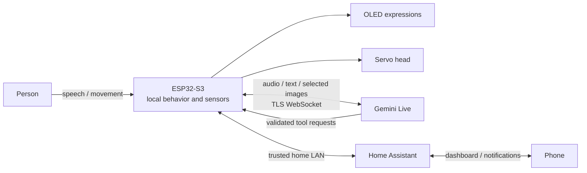

<div align="center">

# Jamiryo

**A tiny desktop companion with expressive eyes and a little attitude.**

ESP32-S3 · ESP-IDF · Gemini Live · Home Assistant



[Build your own](docs/getting-started.md) · [New-home setup](home-assistant/README.md) · [Printable parts](hardware/README.md) · [Hardware & wiring](docs/hardware.md) · [How it works](docs/architecture.md) · [User guide](docs/user-guide.md)

</div>

Jamiryo is a small desk robot built to feel present: it blinks, looks around,
reacts when picked up, and speaks in short, characterful replies. Local C++
behavior runs on an M5Stack AtomS3R-CAM with an Echo/Voice Base. Gemini Live
handles online conversation, and Home Assistant connects the robot to your home.

This is a hobby prototype and a source release, rather than a finished consumer
product. The public snapshot is **1.2.14-public1**. See [validation and known
limits](docs/status.md) before flashing or relying on a feature.

## What it can do

| Feature | How it works |
| --- | --- |
| Expressive OLED eyes | Local blinks, gaze, happy/angry/shy/surprised expressions, pickup `@ @` eyes and a photo shutter effect |
| Voice conversation | Direct Wi-Fi connection to Gemini Live, native audio replies and a local electronic voice effect |
| Physical reactions | BMI270 movement, shake and tilt detection with suppression of the robot's own servo/speaker vibration |
| A movable head | Eased MG90S motion, left/right commands, a look-around routine and intermittent local face tracking |
| Camera interaction | On-demand visual questions; object searches compare three stopped head positions and aim toward the selected view |
| Optional familiar faces | Explicit local enrollment, feature matching and occasional name-based greetings |
| Small persistent memory | Explicit user facts/preferences in NVS; this does not retrain an AI model |
| Home Assistant | Entity discovery, explicit Assist commands and a fresh camera photo sent through a registered phone notification |
| Wi-Fi updates | Paired, authenticated LAN OTA with image/model checks, A/B application slots and boot confirmation |
| Remote message panel | Native HA dashboard for questions, spoken messages and photo requests; prototype delivery tested, with step-by-step English/Turkish setup |

The documentation and included HA dashboard are in English. The current robot
persona, phone setup interface and many fixed phrases remain **Turkish**.
Edit [the public personality prompt](prompts/gemini_buddy.txt) to change its
conversational language and manner; this alone does not translate every UI or tool.

## The idea

Character comes from several small systems working together. A cloud response
can choose an emotion or request a head motion, while the device independently
animates the eyes, handles sensors and keeps motion within fixed limits.
Eyes and physical reactions keep working when the internet is unavailable.
Online conversation and cloud visual interpretation need a working API connection.



Read the [architecture guide](docs/architecture.md) for camera, memory, tool and
remote-message flows, including which data leaves the device.

## Hardware

- M5Stack AtomS3R-CAM AI Chatbot Kit: ESP32-S3, 8 MB flash, 8 MB PSRAM,
  GC0308 camera, BMI270 and the Atomic Voice/Echo Base.
- 1.3-inch 128 × 64 **SH1106-compatible I²C OLED**. This snapshot uses an
  SH1106 driver; SSD1306 is not a guaranteed drop-in replacement.
- MG90S positional servo for one horizontal head axis.
- For portable use: a suitable protected 1S LiPo, compatible charger/5 V boost,
  appropriately rated switch and wiring, and a servo-side reservoir capacitor.

The product photo shows the prototype enclosure. Its three **printable STL
exports** are included: [head, cover and base](hardware/README.md). Read the
mesh/printing notes before use; native parametric CAD and a verified slicer
profile are not included. MPR121 touch, wheels and battery percentage sensing
are not implemented in this snapshot.

Check the [pin table and power diagram](docs/hardware.md) before connecting
anything. OLED supply tolerance does not imply 5 V-tolerant ESP32 data lines.

## Build and first setup

Use an **ESP-IDF 6.0.1** development terminal with the ESP32-S3 toolchain.
The dependency lock records the components used for the reference build.

```sh
python scripts/build.py
```

The script generates original, neutral offline tones, copies the public prompt,
builds this checkout in `.local/build-v2`, and validates/exports the application
to `.local/artifacts/`. It does not read private development folders or contact
a voice service. No personal recordings, portraits or enrolled face profiles
are needed to build.

First-time USB installation must include the partition table, bootloader and
shared face models. An application `.bin` alone is not a factory installation.
Follow [getting started](docs/getting-started.md), then configure **your own**
Wi-Fi, Gemini API key and optional Home Assistant connection.

On a Windows computer paired once over USB, later updates use:

```powershell
./scripts/update_wifi.ps1
```

See [OTA setup and recovery](docs/ota.md). Normal updates need no router port
forwarding and must not be reported as successful until the new image confirms.

## Set up another home

Robot credentials and the Home Assistant dashboard are **two separate setup
steps**. Saving Wi-Fi, Gemini and HA credentials on Jamiryo does not automatically
install a menu on the new HA server.

Follow the illustrated [new-home installation guide](home-assistant/README.md):
create three helpers, add the matching send script/dashboard, select the
Companion phone, then test questions, speaker playback and real photo delivery.
An optional native HA package bundles the helpers and script. Matching
[Turkish templates](home-assistant/tr/README.md) and a portable setup ZIP generator
are included. No credentials are embedded in those files.

## Privacy and accounts

This repository contains source code and generic examples. It does not include
an owner's API key, Wi-Fi password, home token, paired-device key, photos,
recordings, face embeddings, flash backups or previous private Git history.
Every installation supplies its own credentials.

While online conversation is active, microphone audio goes to Google's Gemini
service. Selected images can also be sent for visual requests. Explicit photo
requests upload a fresh image to Home Assistant; the phone notification uses
that authenticated media. Home Assistant and cloud retention are separate from
the robot's temporary RAM buffers. See [privacy and security](docs/privacy.md).

API access, quotas and pricing depend on your Google project and current terms.
A free allocation is not a guarantee of free or unlimited operation. A consumer
chat subscription is not used by this firmware.

## Explore the source

```text
main/
  audio/       microphone capture and voice effects
  behavior/    emotions and visual sleep
  display/     OLED rendering and photo effects
  memory/      bounded persistent notes
  network/     Gemini, Home Assistant, setup portal and OTA
  sensors/     camera, image rotation and local face matching
  servo/       eased motion, tracking, search and motion arbitration
prompts/       public robot character and tool instructions
home-assistant/  English/Turkish dashboard, send script and optional native package
scripts/       isolated build, provisioning and Windows OTA tools
docs/          English setup, hardware, architecture and usage guides
hardware/      head, cover and base STL exports with mesh/printing notes
```

## Current limitations

- Visual sleep with `Zzz` is not ESP32 deep sleep. A custom local “Jamiryo”
  wake-word model and proven low-power standby are not included.
- Audio hardware supports full-duplex I²S, but this firmware gates microphone
  streaming during its own playback. Acoustic echo cancellation and unrestricted
  conversational barge-in are not claimed.
- Servo angles are approximate. There is no shaft feedback or calibrated
  object position; this is not continuous object tracking or a mobile robot.
- Local face matching is experimental recognition, not authentication or an
  access-control mechanism. Enroll only people who agree to participate.
- The public fork has neutral generated tones and a generalized persona.
  Prototype results do not prove this fork has been tested on every module.

## Contributing and license

Read [CONTRIBUTING.md](CONTRIBUTING.md) and [SECURITY.md](SECURITY.md).
Keep credentials and private captures out of issues, screenshots and commits.
Project code, documentation and the supplied product image use the [MIT
license](LICENSE); dependencies and model assets retain their own licenses,
listed in [third-party notices](THIRD_PARTY_NOTICES.md).
