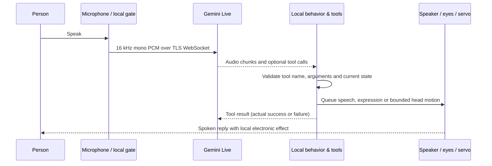
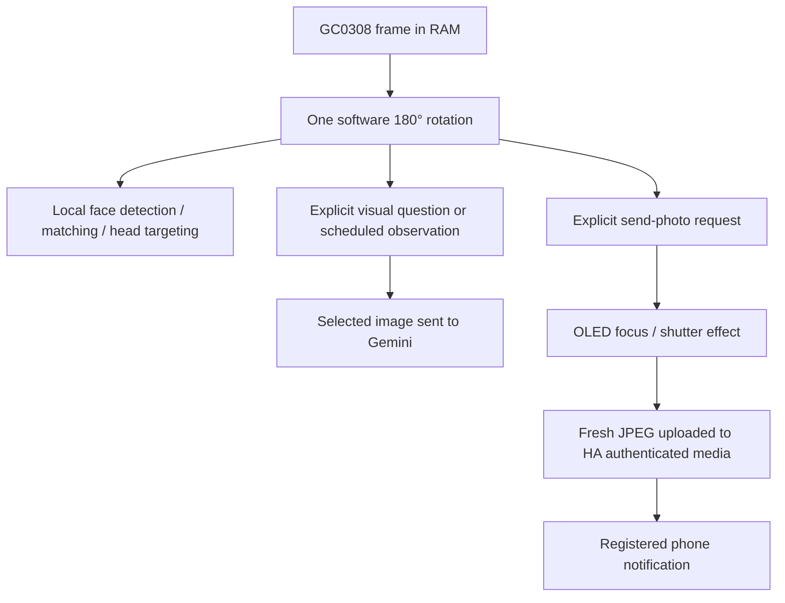

# How Jamiryo works

Jamiryo combines a local behavior engine with an online multimodal conversation.
There is no large language model running on the ESP32-S3. Local pretrained face
models are a separate, much smaller computer-vision function.

## Voice and expression

The ES8311 I²S peripheral is configured for simultaneous input and output, but
the current microphone pipeline pauses cloud streaming while the speaker is
playing and briefly afterward. This avoids self-triggering; it is not an
acoustic echo canceller. Network audio is buffered and resampled for playback.
Camera and face work are scheduled to avoid disrupting speech.

`main/network/gemini_live.cpp` owns the Live session, reconnection and tool
schema. `prompts/gemini_buddy.txt` defines the generalized public character.
Local OLED rendering does not wait for the network. An emotion tool changes
the expression; speech and head motion remain asynchronous.

## Local behavior and motion

- BMI270 samples feed a bounded movement/shake/tilt detector. Self-generated
  motor movement and playback are suppressed as event sources where appropriate.
- Display tasks animate blinks, gaze, strong emotions, pickup `@ @`, shutter
  effects and visual sleep. Strong local effects have explicit priorities.
- A separate MCPWM-driven servo task applies easing and pulse limits. Camera
  LEDC timing is retained. Explicit commands temporarily override automatic motion.
- The automatic head routine can perform an opening sweep, settle, then open
  periodic local face-follow windows. Tracking is one horizontal axis only.
- Two minutes without meaningful interaction starts drowsy eyes; around three
  minutes they close with `Zzz`. A later short sleep remark can use the live
  voice when available. This is visual idle behavior, not low-power deep sleep.

Conversation continuity suppresses unsolicited sensor comments for a short
window after real conversation. It does not permanently store every transcript.

## Camera paths

No streaming camera server is opened by this application. The same corrected
orientation is used by the phone-photo and local face paths. Camera buffers
are temporary RAM; a requested HA photo is a separate stored media object.

For “where is that object?” requests, the head pauses at three positions, captures
fresh views, and sends a numbered composite to Gemini. A validated chosen view
becomes a bounded head target. The system does not estimate a calibrated 3D
position, identify objects without image evidence, or continuously pursue them.

## Memory and familiar faces

Persistent explicit notes/preferences use NVS. The selected information may be
provided to Gemini for context. It does not change model weights. There is no
claim of autonomous online training or unlimited conversation memory.

Face enrollment explicitly associates a user-chosen label with local feature
vectors in `face_store`. Matching runs locally and can drive an occasional
greeting after consistency/cooldown checks. It is not identity verification;
labels may be included in a cloud conversation when that interaction is used.
The public source ships no enrolled people or portrait test fixtures.

## Home Assistant and remote messages

HA entity discovery uses bounded templates/pagination. Commands follow the
targets and actions exposed to Assist. Only explicit requests should initiate
home actions, photos or outgoing text notifications; camera/idle events are
not authorization to control the house.

The optional remote panel commits one `J1:` JSON envelope to a fixed
`input_text` helper. The robot polls it, validates its mode, length and age,
then writes an acknowledgement to NVS **before** starting an action. Requests
expire after two minutes. The last claimed request ID prevents routine polling
or a restart from replaying it automatically; a claimed action whose outcome
was lost may be reported as unconfirmed rather than repeated.

- `ask` sends an explicit text question to the Live session and publishes its
  output transcript back to the panel.
- `say` asks the voice to read the supplied text; smart-home/action tools are
  gated off except expression updates.
- `photo` captures/uploads through HA directly without asking Gemini.

`sensor.jamiryo_messenger` carries a heartbeat, processing state and last result.
Notification acceptance is distinct from the phone actually displaying it.
This panel still requires final device-to-phone acceptance testing.

## OTA and flash layout

The application has two A/B slots. Local home/face data and the two shared model
partitions are outside those slots. A firmware contract binds the image to the
ESP32-S3 target, project/layout and exact model hashes. Updates write the inactive
application slot; startup health checks confirm the new image or allow rollback.
See [OTA](ota.md) for pairing, the HMAC challenge and limitations.
