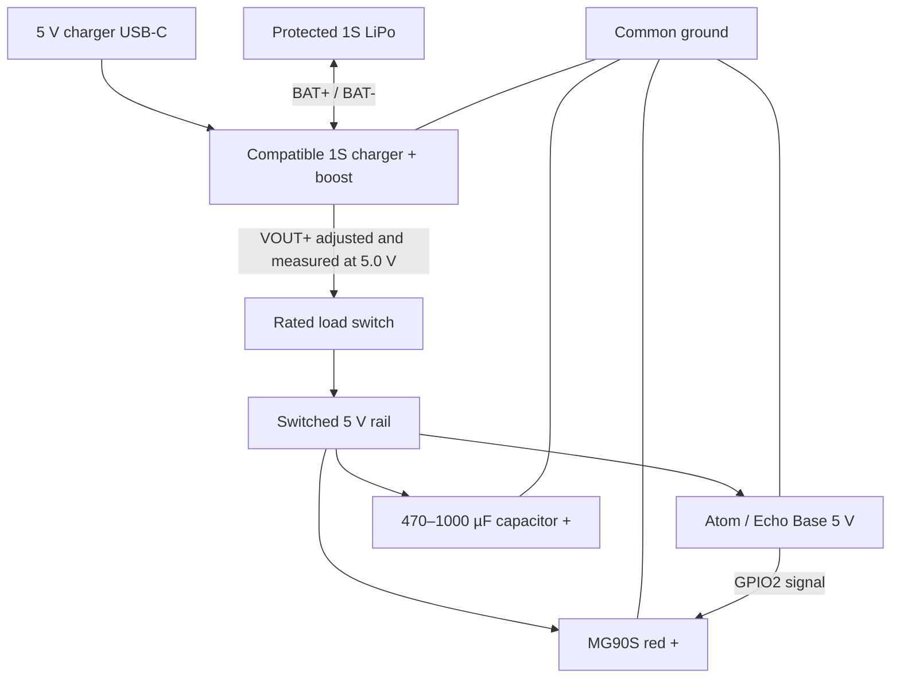

# Hardware and wiring

## Reference parts

| Part | Purpose / compatibility |
| --- | --- |
| M5Stack AtomS3R-CAM AI Chatbot Kit | ESP32-S3-PICO-1-N8R8, 8 MB flash and PSRAM, GC0308 camera, BMI270, ES8311 microphone/speaker base |
| 1.3-inch 128 × 64 SH1106-compatible I²C OLED | Two expressive eyes; reference board is marked JMD 1.3A |
| MG90S positional servo | Horizontal head rotation; model name alone does not guarantee identical pulse/angle limits |
| Protected 1S 3.7 V LiPo | Portable power; reference size is 603450 / 1200 mAh, not a mandatory current rating |
| Compatible 1S charger plus regulated 5 V boost | Battery charging and robot/servo supply; verify the actual module's pads and capabilities |
| Rated switch, wire and optional 470–1000 µF / ≥10 V capacitor | Main load switch and servo supply decoupling |

The [official M5Stack pin map](https://docs.m5stack.com/en/core/AtomS3R-CAM_AI_Chatbot)
is the reference for the Atom and base. Different bases and OLED breakout
boards may use different electrical arrangements.

## Signals used by this firmware

| Connection | Signal |
| --- | --- |
| Echo Base I/O EXT `G` | Common ground |
| Echo Base I/O EXT `5` | Regulated 5 V supply rail |
| Echo Base I/O EXT `SDA` | GPIO38; shared OLED/codec control bus |
| Echo Base I/O EXT `SCL` | GPIO39; shared OLED/codec control bus |
| Atom's USB-side HY2.0-4P yellow wire | GPIO2; servo signal |
| Atom's USB-side HY2.0-4P black wire | Ground |
| Atom's USB-side HY2.0-4P red wire | 5 V rail |
| Atom's USB-side HY2.0-4P white wire | GPIO1; unused here |

The standard M5 cable colors above are a reference, not a substitute for checking
the connector labels/orientation. The Echo Base's separate G/5/SDA/SCL connector
is not interchangeable with the Atom's GND/5V/G2/G1 connector.

Built-in audio uses BCLK GPIO8, WS GPIO6, output GPIO5 and input GPIO7. The IMU
uses SDA GPIO45 and SCL GPIO0. Camera pin assignments are in
`main/sensors/camera.cpp`; do not repurpose them for a servo.

## OLED

Connect OLED GND to common ground, SDA to GPIO38 and SCL to GPIO39. The firmware
looks for 0x3C or 0x3D and uses SH1106 page addressing. Keep wires short.

Choose the OLED supply according to the **actual breakout board**. Some modules
accept 5 V power while regulating their I²C pull-ups to 3.3 V; others pull SDA/SCL
up to VCC. The ESP32 data pins must not be pulled to 5 V. With data wires still
disconnected from the Atom, verify the powered module's idle SDA/SCL voltage
against GND, or use a documented 3.3 V supply/appropriate level translation.
A seller's “3–5 V” VCC statement alone is insufficient.

## Portable power diagram

| Charger/boost pad | Connection |
| --- | --- |
| `BAT+` / `BAT-` | Battery positive / negative, with polarity verified |
| `VOUT+` | Switch common terminal; one outer switch terminal feeds the 5 V load rail |
| `VOUT-` | Common ground for Atom, OLED and servo |
| `IN+` / `IN-` | External charging input when documented by that module; not the battery/output terminals |

For a typical MG90S: red is supply positive, brown is ground and orange is signal.
Verify your actual servo. Feed servo current directly from the supply branch,
not through a GPIO or a thin controller signal path. Place the capacitor close
to the servo branch with its marked negative lead on GND.

Set and measure the boost output **before** connecting the robot. Use a supply
and battery capable of simultaneous Wi-Fi, speaker and motor peaks. A capacitor
cannot make an undersized battery or boost converter adequate. The 1200 mAh
capacity label does not establish safe charge/discharge current.

Charge current must match the cell's specification. A board described as TP4056
plus boost does not automatically provide load sharing/power-path management;
charge with the robot off unless your actual module documents simultaneous use.
The switch shown disconnects the robot/servo load, while the boost and battery
can remain connected and consume standby current.

For USB servicing, physically isolate the external positive supply and servo
power first. A load switch's position alone does not prove every 5 V path is
isolated. Do not parallel USB and boost outputs without a verified power-path
design. Routine paired Wi-Fi updates avoid that rewiring.

## Mechanical limits

Keep the camera's view separate from the OLED window. Leave microphone/speaker
openings and room for wiring to flex during head rotation. There is no slip
ring: use bounded movement and never wind the cable around the axis. Mount the
battery low, secure it without compression/puncture, and check head clearance.

The present code does not measure battery voltage or percentage. GPIO1 is spare,
but a LiPo must not be connected directly to an ESP32 ADC pin. Adding sensing
requires an appropriate divider/protection and firmware that is not included here.
