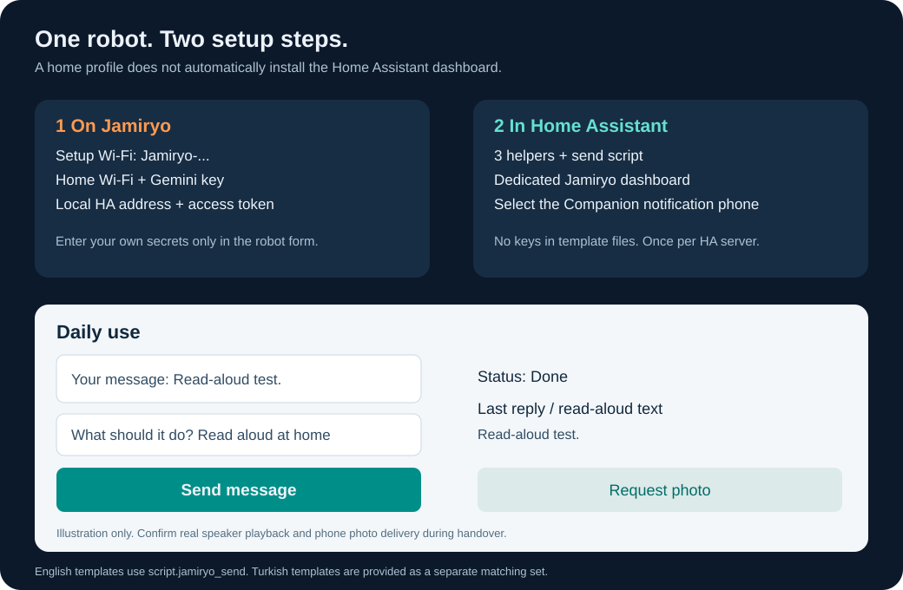

# Set up Jamiryo in a new home

**Saving a home profile on the robot does not install this Home Assistant
dashboard.** Configure the robot, then install three helpers, one script and
one dedicated dashboard. Repeat once for each different HA server.



Illustration with generic examples, not a live household screenshot. No HACS,
MQTT broker or custom integration is required. This folder contains the English
set. For Turkish labels use [the matching Turkish set](tr/README.md); do not mix
their mode labels or script IDs. Public source snapshot: **1.2.14-public1**.

## 1. Configure the robot's home profile

Prepare your home's 2.4 GHz Wi-Fi, Gemini API key, local HA base URL and HA
long-lived access token. Create the token in your HA **user profile → Security →
Long-lived access tokens**. Google keys come from [Google AI Studio](https://aistudio.google.com/api-keys).
Keep both private; no YAML file in this folder needs credentials.

Say **“Ev kurulumunu aç.”** to open robot setup. Without a working saved network,
the robot also attempts setup after about 30 seconds. Join its `Jamiryo-...`
Wi-Fi using the password provided by its builder. Open the captive portal or
**http://198.18.0.1/** while connected to that network.

Save a home name, Wi-Fi details, Gemini key, HA URL and HA token. The current
wizard is Turkish and requires a complete HA profile. Use a local HTTP base URL,
such as `http://homeassistant.local:8123`; the robot client does not support an
HTTPS/reverse-proxy base URL. After the robot restarts, return the phone to home
Wi-Fi. [First setup](../docs/getting-started.md) explains flashing, setup passwords
and the wizard labels. Model access/quotas depend on your Google project.

## 2. Create three helpers in Home Assistant

Recommended UI method: **Settings → Devices & services → Helpers → Create helper**.
Verify exact entity IDs, not just display names:

| Type | Suggested name | Required entity ID | Setting |
| --- | --- | --- | --- |
| Text | Jamiryo message | `input_text.jamiryo_message` | Minimum 0, maximum 140, plain text |
| Text | Jamiryo inbox | `input_text.jamiryo_inbox` | Minimum 0, maximum 255, plain text |
| Dropdown | Jamiryo mode | `input_select.jamiryo_mode` | The three exact options below |

```text
Ask Jamiryo
Read aloud at home
Send photo
```

Initialize both text helpers to an empty string once. If needed, use
**Developer tools → Actions → YAML mode**:

```yaml
action: input_text.set_value
target:
  entity_id:
    - input_text.jamiryo_message
    - input_text.jamiryo_inbox
data:
  value: ""
```

The inbox is internal and absent from the form. Do not edit/clear it during normal
use or while a request is pending. Experienced YAML users may instead use the
[native package method](package-install.md) for steps 2 and 3. Choose one method.

## 3. Add the send script

Open **Settings → Automations & scenes → Scripts → Create script → Create new
script**. In its menu choose **Edit in YAML**. Replace the empty script with all
of [jamiryo_send.yaml](jamiryo_send.yaml), without a Markdown code fence.

Save as **Send to Jamiryo**. Verify the entity ID is **`script.jamiryo_send`**.
These files use JSON syntax, which is valid YAML. Do not paste the dashboard
file into the script editor or put the script in `configuration.yaml`.

## 4. Add the separate dashboard

In **Settings → Dashboards**, create a new empty dashboard: title **Jamiryo**,
URL path **`jamiryo-mesaj`**, shown in the sidebar. Open it, then choose
**Edit dashboard → menu → Raw configuration editor**. Paste the complete
[jamiryo_dashboard.yaml](jamiryo_dashboard.yaml), save, and leave editing mode.
Do not replace your normal home dashboard.

The view path remains **`sohbet`**: `/jamiryo-mesaj/sohbet`. Keep these URL paths
in English installs too; notification click targets use them. The robot creates
`sensor.jamiryo_messenger` itself; do not create that sensor as a helper.
Wait for **Connected and ready**.

## 5. Select the phone

Register your phone with this same HA server in the official **HA Companion app**
and enable notifications. In robot setup, use **Fotoğraflı bildirim → Telefonları
bul → Bu telefona gönder** to select it. One discovered phone can be selected
automatically; choose explicitly if several exist. Return to home Wi-Fi.
Photos require authenticated local HA media and media-upload permission; the
prototype uses an administrator HA token. Do not put that token in these files.

For voice control of home devices, separately expose intended entities to
**Assist**, with useful names and rooms. This dashboard does not expose all devices.

## 6. Test before handing over

| Check | Action | Actual success |
| --- | --- | --- |
| Text | Ask Jamiryo: `İki artı iki kaç eder?` → Send message | Relevant reply in panel and a phone notification |
| Speaker | Read aloud at home: a short harmless test → Send message | Listen to the robot; it finishes without an error |
| Photo | Request photo; no text needed | New notification arrives and its expanded image is visible |
| Away from home | Open HA through your configured Tailscale/private access | Dashboard and authenticated media both load |

Save the draft by pressing Enter/Done or leaving the field. **Send message** is
the only send button for the draft; **Request photo** is a separate shortcut.
On phones the status/reply may appear below the form. Template labels are English,
while default robot speech and many firmware phrases remain Turkish.

Read-aloud shows the actual transcript when returned. If audio finished without
a transcript, your requested text is shown with a clear note. “Done” confirms
software playback, not that someone heard every word or an independent transcript.

## Troubleshooting and limits

| Symptom | First check |
| --- | --- |
| Missing entity / unknown mode | Exact helper IDs, exact options, matching language set |
| Send button fails | Exact script ID and the current complete dashboard file |
| Offline | Robot power, selected home profile, local HA URL/token, same LAN |
| Voice timeout / interrupted reading | Wait until ready and explicitly send again; avoid repeated taps |
| No notification | Selected phone, Companion registration and Android notification permissions |
| No image | Test on home Wi-Fi first; app/media access and HA upload permission |
| Only works at home | Configure phone-to-HA private access and authenticated media access separately |

Drafts allow 140 characters; the full JSON request must also fit 255 characters.
Quotes/escaping can reduce usable length. Requests expire after two minutes;
queue wait is bounded at 60 seconds and reply/playback at 90 seconds. Failed
requests do not replay automatically after restart. A person in the room can
explicitly say **“Telefonuma mesaj gönder: ...”** to reply to the selected phone.
Ordinary room speech is not forwarded automatically.

## Another house or another owner

Each different HA server needs its own helpers/script/dashboard. Switching the
robot's home profile selects Wi-Fi, Gemini and HA credentials together, but does
not copy a dashboard or erase old profiles, shared notes or enrolled faces.
Arrange a verified cleanup/revocation before ownership transfer. Do not share
pairing registries, flash/NVS backups, credentials or private captures.

## Files and portable bundle

- [Send script](jamiryo_send.yaml) and [dashboard](jamiryo_dashboard.yaml): UI method.
- [Native package](jamiryo_package.yaml): optional helpers + script, [instructions](package-install.md).
- [Turkish templates and instructions](tr/README.md).

Download the repository with **Code → Download ZIP**, or generate a small setup
bundle containing both language sets and this illustration:

```sh
python scripts/ha_message_bundle.py --bundle dist/jamiryo-home-assistant-setup.zip
```

The bundle has no credentials. General firmware guide links refer to the full
repository. Prototype tests on 27 October 2026 confirmed question/reply delivery,
audible read-aloud and photos across prototype versions 1.2.11-1.2.14. The public
fork has different neutral assets/persona and needs its own hardware acceptance.
See [validation](../docs/status.md).

Official references: [helpers](https://www.home-assistant.io/integrations/input_text/),
[scripts](https://www.home-assistant.io/integrations/script/),
[packages](https://www.home-assistant.io/docs/configuration/packages/),
[dashboards](https://www.home-assistant.io/dashboards/dashboards/),
[phone images](https://companion.home-assistant.io/docs/notifications/notification-attachments/).
